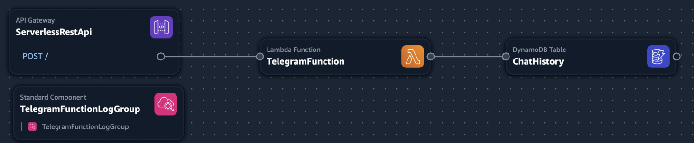
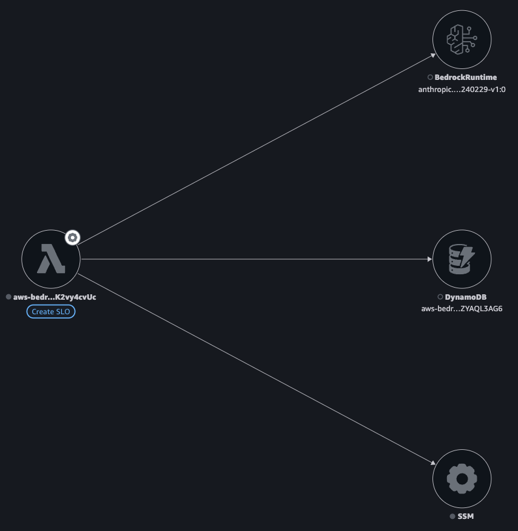

# AWS Bedrock Telegram GenAI Chatbot
Telegram conversational GenAI bot, powered by Amazon Bedrock, using PTB, hosted on AWS Serverless

- Uses the [python-telegram-bot](https://pypi.org/project/python-telegram-bot/) telegram bot framework, using [this project](https://github.com/jojo786/Sample-Python-Telegram-Bot-AWS-Serverless-PTBv20) to run PTB on AWS Serverless
- GenAI conversational capabilities powered by Amazon Bedrock, using the Claude Sonnet 4.5 LLM
- Supports [response streaming](https://aws.amazon.com/blogs/compute/building-responsive-apis-with-amazon-api-gateway-response-streaming/) for real-time chat experience, using APIGateway Response Streaming and Lambda response streaming with FastAPI and Lambda Web Adapter
- Implements real-time streaming responses using Telegram Bot API 9.3's `sendMessageDraft` feature for live typing effects

## Response Streaming Architecture

This bot implements end-to-end response streaming from AWS API Gateway to Telegram users:

1. **API Gateway Response Streaming**: Configured with `responseTransferMode: "STREAM"` to enable streaming from Lambda
2. **Lambda Response Streaming**: Uses `invoke_model_with_response_stream` with Amazon Bedrock for real-time AI responses
3. **Telegram Draft Updates**: Leverages Telegram Bot API 9.3's `sendMessageDraft` to show live typing effects
4. **PTB v22.6 Support**: Uses python-telegram-bot v22.6 which supports the latest Telegram Bot API 9.3

### Streaming Flow:
- User sends message → API Gateway (streaming enabled) → Lambda function
- Lambda streams from Bedrock → Updates Telegram draft message in real-time → Sends final complete message

**Key Technologies:**
- [Telegram Bot API 9.3](https://core.telegram.org/bots/api-changelog#december-31-2025) - Introduced `sendMessageDraft` for real-time message updates
- [python-telegram-bot v22.6](https://docs.python-telegram-bot.org/en/v22.6/changelog.html) - Added support for Telegram Bot API 9.3
- [AWS API Gateway Response Streaming](https://serverlessland.com/patterns/apigw-rest-api-lambda-python-response-streaming-pattern) - Enables streaming responses from Lambda
- [Serverless Streaming Pattern](https://github.com/aws-samples/serverless-patterns/tree/main/apigw-rest-api-lambda-python-response-streaming) - Reference implementation for AWS serverless streaming 

# Architecture
Requests from Telegram come in via an Amazon API Gateway endpoint with response streaming enabled, which get routed to a Lambda function running FastAPI with Lambda Web Adapter. The Lambda function gets the Telegram Token and API Secret Token from SSM Parameter Store for secure authentication. Requests are sent to Amazon Bedrock with support for response streaming and chain of thought reasoning. Chat history and user settings are maintained in DynamoDB with TTL and Global Secondary Index for efficient querying. Logs are stored on CloudWatch. All deployed using AWS SAM IaC. Monitoring services like X-Ray, Lambda Insights and Application Signal are all enabled for comprehensive monitoring.

# Features

## Core Capabilities
- **Conversational AI**: Natural language conversations powered by Claude Sonnet 4.5
- **Real-time Streaming**: Live typing effects using Telegram's draft message updates during AI response generation
- **Document Analysis**: Upload and analyze PDF, DOC, DOCX, and TXT files (up to 4.5MB)
- **Chat History**: Persistent conversation history with automatic 1-hour TTL
- **Response Streaming**: End-to-end streaming from Bedrock through API Gateway to Telegram for instant user feedback

## Bot Commands
- `/start` - Initialize the bot and get welcome message
- `/status` - Show bot health, Lambda function version, execution time, and remaining timeout
- `/debug` - Toggle debug mode to show Bedrock response times and usage metrics
- `/thinking` - Enable/disable Claude's chain of thought reasoning display
- `/clear` - Delete all chat history for the current user

## Advanced Features
- **Chain of Thought**: See Claude's reasoning process when enabled
- **Security**: Telegram API Secret Token validation for webhook security
- **Multi-region Support**: Supports different Claude model regions (US, AF, Global)
- **Auto-cleanup**: Chat history and settings automatically expire after 1 hour
- **Health Monitoring**: Built-in health check endpoint for monitoring
- **Comprehensive Logging**: Detailed logging with CloudWatch integration
# How it works

## Standard Message Flow
- A Telegram bot has been created with the webhook URL set to point to the Amazon API Gateway endpoint. When a user interacts with the bot, requests are sent to API Gateway
- API Gateway receives the request and forwards to a Lambda function
- The Lambda function processes the request by:
  - Retrieving the Telegram token from SSM Parameter Store
  - Managing chat history by storing the new request in DynamoDB and retrieving previous messages
  - Sending the request to Amazon Bedrock and parsing the response
  - Saving the response in DynamoDB to maintain chat history
  - Sending the response back to the Telegram user

## Streaming Response Flow
- **Step 1**: User sends message → Telegram webhook → API Gateway (with streaming enabled)
- **Step 2**: Lambda function receives request and sends initial "Thinking..." draft message to Telegram
- **Step 3**: Lambda calls `bedrock.invoke_model_with_response_stream()` to get streaming AI response
- **Step 4**: As Bedrock streams response chunks, Lambda updates the Telegram draft message in real-time using `sendMessageDraft`
- **Step 5**: When streaming completes, Lambda sends the final complete message and saves to DynamoDB
- **Step 6**: User sees live typing effect as the AI response is generated, providing immediate feedback

This creates a ChatGPT-like experience where users see the AI "typing" the response in real-time rather than waiting for a complete response.

# How to run it
- Create your bot using [BotFather](https://core.telegram.org/bots#3-how-do-i-create-a-bot), and note the token, e.g. `12334342:ABCD124324234`
- Install [AWS CLI](https://docs.aws.amazon.com/cli/latest/userguide/install-cliv2.html), and  [configure it](https://docs.aws.amazon.com/cli/latest/userguide/cli-configure-quickstart.html#cli-configure-quickstart-config)
- Install [AWS SAM CLI](https://docs.aws.amazon.com/serverless-application-model/latest/developerguide/serverless-sam-cli-install.html)
- Create SSM Parameters to store the Telegram credentials:
  - Bot token: `aws ssm put-parameter --region us-east-1 --name "/bedrock-telegram-genai-chatbot/telegram/prod/bot_token" --type "SecureString" --value "12334342:ABCD12432423" --overwrite`
  - API Secret token: `aws ssm put-parameter --region us-east-1 --name "/bedrock-telegram-genai-chatbot/telegram/prod/api_secret_token" --type "SecureString" --value "your-secret-token" --overwrite`
- Run `sam build && sam deploy --guided`. Provide a stack-name, and use `us-east-1` as the region (mostly due to Bedrock). 
- Note the Outputs from the above `sam deploy` command, which will include the Value of the TelegramApi, which is the API GW / Lambda URL endpoint, e.g. `https://1fgfgfd56.lambda-url.eu-west-1.on.aws/` 
- Update your Telegram bot to change from polling to [Webhook](https://core.telegram.org/bots/api#setwebhook), by pasting this URL in your browser, or curl'ing it: `https://api.telegram.org/bot12334342:ABCD124324234/setWebHook?url=https://1fgfgfd56.lambda-url.eu-west-1.on.aws/bot&secret_token=your-secret-token`. Use your bot token, API GW endpoint, and secret token. You can check that it was set correctly by going to `https://api.telegram.org/bot12334342:ABCD124324234/getWebhookInfo`, which should include the `url` of your API GW endpoint, as well as any errors Telegram is encountering calling your bot on that webhook.

# Usage Examples

## Basic Chat
Just send any message to start a conversation with Claude.

## Document Analysis
1. Upload a PDF, DOC, DOCX, or TXT file (max 4.5MB)
2. The bot will automatically analyze the document and provide insights
3. Citations will be included when available

## Debug Mode
1. Send `/debug` to toggle debug mode
2. When enabled, you'll see Bedrock response times and token usage
3. Send `/debug` again to disable

## Chain of Thought
1. Send `/thinking` to enable Claude's reasoning display
2. You'll see Claude's thought process before the final response
3. Send `/thinking` again to disable

## Managing Chat History
- Send `/clear` to delete all your chat history
- History automatically expires after 1 hour for privacy